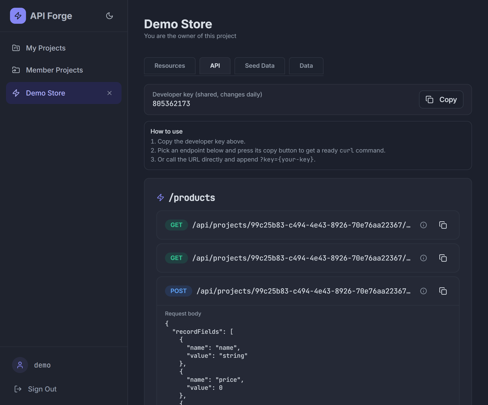

# ⚡ ApiForge


**ApiForge** is a self-hosted tool that turns your data models into a fully working REST API in seconds.

Define a project, describe your models (resources) with typed fields, and ApiForge instantly generates a complete CRUD API — with pagination, sorting, filtering, an access key, and even smart seed data. No boilerplate, no code generation, just a running API.

Built with **.NET 9** and **React + Vite + shadcn/ui**.



---

## ✨ Features

### Accounts & security
- Registration / login / logout with cookie **and** JWT auth (a single "smart" scheme that accepts both).
- Password policy (min 6 chars), account lockout after failed attempts, and a "must change password" flow.
- Blocked-account guard on the frontend.

### Projects & collaboration
- Create, rename, delete projects; ownership and membership model.
- Invite collaborators by email; accept / decline / cancel invitations.
- Owner and member roles with per-project access control.

### Models (resources)
- Define models with typed fields: `string`, `int`, `double`, `bool`, `guid`.
- Model names are unique per project and become part of the generated URL.
- Reserved names (`definitions`, `members`, `invitations`) are protected from collisions.
- Field names/types are validated; duplicate field names are rejected.
- Add/remove fields later — existing records are automatically backfilled.

### Generated REST API
- Full CRUD per model: create, list, get one, update, delete, delete-all.
- **Pagination** (`?page`, `?pageSize`), **sorting** (`?sort`, `?order`), and **filtering** (`?field=value`, repeatable).
- **Developer key** — a daily, shared code so you can call the API without logging in (`?key=…`).
- In-app **API docs** with endpoints, request-body examples and copy-paste `curl` commands (key included).

### Data & seeding
- **Data browser** with collapsible tables, inline editing, delete and clear-all.
- **Smart seed data** that generates realistic values from field names (`email`, `phone`, `price`, `name`, `city`, …) — with a pattern reference and fill/create modes.

### UX
- Indigo-themed UI with a **light / dark mode** toggle (follows your system by default).

---

## 🧱 Tech stack

| Layer     | Tech |
|-----------|------|
| Backend   | .NET 9, ASP.NET Core, Entity Framework Core, ASP.NET Identity + JWT, SQL Server |
| Frontend  | React 18, TypeScript, Vite, Tailwind CSS, shadcn/ui, Framer Motion |
| Infra     | Docker + Docker Compose |

---

## 🚀 Getting started

### Prerequisites

- **Docker** (with Docker Compose)
- **.NET SDK 9** (for local backend development / running tests)
- **Node.js 18+** (for local frontend development)

### 1. Clone the repository

```bash
git clone https://github.com/glafver/api-forge.git
cd api-forge
```

### 2. Configure the `.env` file

Create a `.env` file in the project root (never commit it):

```dotenv
# SQL Server credentials
DB_NAME=apiforge
DB_PASSWORD=change-me
DB_ID=sa
DB_SERVER=apiForge-sqlserver

# Secret salt used to derive the daily developer key (keep it private)
DEV_KEY_SALT=some-long-random-string
```

### 3. Start the stack

```bash
docker compose up -d --build
```

This will:

- start a SQL Server container (`apiForge-sqlserver`);
- build and start the app container (`api-forge-app`);
- apply EF Core migrations and seed the default role automatically;
- serve the app and API at **http://localhost:8080**.

> Port 8080 in use by another project? Add a local `docker-compose.override.yml` (git-ignored) to remap the host port, e.g. `8095:8080`.

### Stopping

```bash
docker compose stop          # stop all services
docker stop api-forge-app    # stop just the app
docker stop apiForge-sqlserver
```

---

## 🔑 Environment variables

| Variable        | Description |
|-----------------|-------------|
| `DB_NAME`       | SQL Server database name |
| `DB_PASSWORD`   | SQL Server `sa` password |
| `DB_ID`         | SQL Server login (usually `sa`) |
| `DB_SERVER`     | SQL Server host (`apiForge-sqlserver` inside Docker) |
| `DEV_KEY_SALT`  | Secret salt for the daily developer key |

---

## 📡 How the generated API works

For every model you define in a project, ApiForge exposes:

```
GET    /api/projects/{projectId}/{model}          list records
POST   /api/projects/{projectId}/{model}          create a record
GET    /api/projects/{projectId}/{model}/{id}     get one record
PUT    /api/projects/{projectId}/{model}/{id}     update a record
DELETE /api/projects/{projectId}/{model}/{id}     delete a record
DELETE /api/projects/{projectId}/{model}          delete all records
```

### List query parameters

| Parameter    | Description |
|--------------|-------------|
| `page`       | Page number (default `1`) |
| `pageSize`   | Records per page (default `20`, max `100`) |
| `sort`       | Field name to sort by |
| `order`      | `asc` or `desc` (default `asc`) |
| `field=value`| Filter records where `field` equals `value` (repeatable) |

### Developer key

Each project has a **daily developer key** shared by all members. It is a 9-digit code derived from `SHA256(projectId + date + DEV_KEY_SALT)`, so it changes every day and is never stored.

Append `?key=…` to any generated endpoint to call it without logging in:

```bash
curl "http://localhost:8080/api/projects/{projectId}/products?key=123456789"
```

---

## 🧪 Worked example: a `products` API

1. In the UI, create a project and add a model named `products` with three fields:
   `name` (string), `price` (double), `in_stock` (int).

2. Grab the developer key from the **API** tab, then create a record:

```bash
curl -X POST "http://localhost:8080/api/projects/{projectId}/products?key=123456789" \
  -H "Content-Type: application/json" \
  -d '{"recordFields":[{"name":"name","value":"Keyboard"},{"name":"price","value":"49.99"},{"name":"in_stock","value":"25"}]}'
```

3. List records, sorted by price (descending):

```bash
curl "http://localhost:8080/api/projects/{projectId}/products?key=123456789&page=1&pageSize=10&sort=price&order=desc"
```

```json
{
  "page": 1,
  "pageSize": 10,
  "totalCount": 1,
  "totalPages": 1,
  "items": [
    {
      "id": "0f8fad5b-d9cb-469f-a165-70867728950e",
      "fields": [
        { "name": "name", "value": "Keyboard" },
        { "name": "price", "value": "49.99" },
        { "name": "in_stock", "value": "25" }
      ]
    }
  ]
}
```

4. Filter records where a field matches a value:

```bash
curl "http://localhost:8080/api/projects/{projectId}/products?key=123456789&in_stock=0"
```

---

## 🌱 Smart seed data

The **Seed Data** tab generates realistic values based on field names — `email` → `john@example.com`, `phone` → `+1 555-…`, `price` → `123.45`, `name` → a random full name, `age`/`count` → a number, `city`/`country` → a place, and so on.

For existing records you can either **fill missing values** in empty fields, or **create new records** — with a built-in reference of the recognized patterns.

---

## 🧪 Testing

The backend ships with a suite of unit tests for field/record validation:

```bash
dotnet test backend.Tests/backend.Tests.csproj
```

---

## 📁 Project structure

```
api-forge/
├─ backend/                 # ASP.NET Core Web API
│  ├─ ApplicationUser/      # auth, users, JWT
│  ├─ Projects/             # projects, members, invitations
│  ├─ Definition/           # model (resource) definitions
│  ├─ ModelRecords/         # generated record CRUD + validation
│  ├─ AppConfig/            # startup, migrations, dev-key generator
│  └─ Program.cs
├─ backend.Tests/           # xUnit tests
├─ frontend/                # React + Vite + shadcn/ui
│  └─ src/
│     ├─ pages/             # Login, Register, Projects, ApiForge, Profile
│     └─ components/api-forge/  # Resources, API, Seed, Data tabs
├─ docker-compose.yml
├─ Dockerfile
└─ .env                     # local secrets (git-ignored)
```

---

## 🙌 Credits

Forked from [nrazv/ApiForge](https://github.com/nrazv/ApiForge) and extended with the generated-API engine, developer keys, smart seeding, collaboration, and dark mode.
